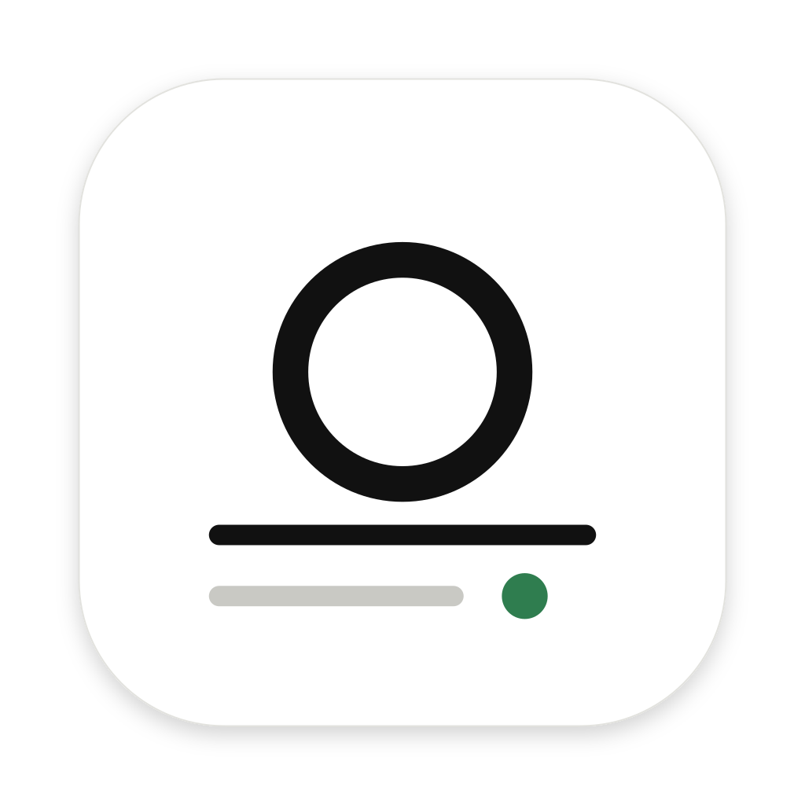

<p align="center">
  
</p>

# Oats

**Real-time meeting notes for macOS — on-device by default, Mistral online if you choose.**

Oats (formerly **iciTranscript**) captures your microphone and your Mac's system audio, transcribes both in real time, and keeps a complete transcript of every meeting. Transcription runs on your Mac with MLX models, or online with Mistral Voxtral when you pick it. Summaries and an English coach are optional. Oats keeps transcripts, not recordings.

---

## Features

- **Real-time transcription, two engines** — choose in **Réglages › Moteur de transcription**:
  - **Sur ce Mac** (default): [voxmlx](https://github.com/T0mSIlver/voxmlx) on Apple Silicon MLX, nothing leaves your Mac
  - **Mistral (en ligne)**: [Voxtral](https://docs.mistral.ai/) realtime, no local transcription model, lighter on the Mac; needs a Mistral API key and online sending turned on (diarization stays on your Mac)
- **Two audio sources, kept separate** — your microphone and the system audio (calls, videos) are two streams, so the note knows who said what ("Vous" vs. the other side)
- **No silent loss** — a passage that could not be transcribed live is marked in the note and transcribed again after the meeting; a full disk, a lost connection or a crash is shown, never hidden. Every sentence is in the note or under a visible marker
- **Notes by day** — every meeting is listed on the home page, grouped by day, with search
- **Speaker diarization** — after a meeting, remote participants are separated and labelled, up to 8 speakers, with NVIDIA Nemotron 3 Diarization on MLX ([nemotron-diar-mlx](https://github.com/9clg6/nemotron-diar-mlx)); the model (~400 MB) is downloaded on first use
- **Dictation** — hold a shortcut (for example ⌥⌘ alone) and speak: the text is pasted into the app in front, or copied to the clipboard
- **Menu bar panel** — note state and time, start / pause / stop, the last transcript lines and the current question, without opening the window; closing the window keeps a recording going
- **Summaries and English coach (optional)** — a local [Mistral](https://mistral.ai) model via Ollama, installed from **Réglages › Modèle local** (Ollama ~106 MB + model ~4 GB), or an online provider. Long meetings are summarised in full, part by part
- **Online providers (optional, off by default)** — Mistral, Claude, OpenAI or Gemini with your own API key (stored in the macOS Keychain), once you turn on online sending in **Réglages**
- **Documents** — add .txt, .md or .pdf files as sources for answers during your meetings; their text is indexed on your Mac
- **Export** — copy a transcript or export it as Markdown to `~/Downloads/`

---

## Minimum Requirements

| Component | Minimum | Recommended |
|-----------|---------|-------------|
| macOS | 13 Ventura | 14 Sonoma or later |
| Chip | Apple M1 | Apple M2 / M3 |
| RAM | 8 GB | 16 GB |
| Disk | 5 GB free | 10 GB free |

> **Why Apple Silicon?** On-device transcription and diarization use MLX, Apple's machine learning framework for M-series chips. Intel Macs are not supported.

---

## Installation

1. **Download** `Oats-vX.Y.Z.dmg` from [GitHub Releases](../../releases)
2. **Drag** Oats into your Applications folder
3. **Right-click › Open** on first launch (Gatekeeper warning — the app is ad-hoc signed)
4. Grant **Microphone** and **Screen Recording** permissions when prompted (and **Accessibility** if you want dictation to paste)

`uv` (used to run the local transcription server) is installed by the app on first launch if missing. The local model for summaries is optional and installed only when you ask for it in Réglages.

Data stays where iciTranscript kept it (`~/Library/Application Support/IciTranscript/`), so existing notes and models carry over.

---

## Development

### Prerequisites

- Flutter SDK 3.x
- Xcode 15+
- `uv` — [astral.sh/uv](https://astral.sh/uv)

### Getting started

```bash
cd apps/app_macos && flutter pub get
flutter run -d macos     # debug run
flutter test             # tests
flutter analyze          # lints
cd ../.. && make build   # release build (Oats.app)
make dmg                 # Oats-vX.Y.Z.dmg
```

### Project structure

```
apps/app_macos/        — Flutter macOS application
packages/
  core_domain/         — Entities, use cases, repository interfaces
  core_data/           — Repository implementations, Drift SQLite database
  core_foundation/     — Logger, config, shared utilities
  core_presentation/   — Oats design tokens, theme and shared widgets
design/logo/           — App, small and menu bar icons (SVG)
```

### Architecture

- **Presentation** — Flutter widgets + Riverpod ViewModels (Freezed state)
- **Application** — LiveTranscriptionService orchestrating audio capture, transcription and database
- **Domain** — Pure Dart use cases and entities
- **Data** — Drift SQLite + platform channels (Swift) for audio and process management

With the local engine, the transcription server (`voxmlx-serve`) runs as a child process launched by the app via `uvx`. It listens on `ws://127.0.0.1:8000` (8100 for a dev build on its own data directory; live diarization uses 8001/8101) and streams transcript segments back in real time. The app records the servers it starts in `servers.json` in its data directory and only ever stops those; a port held by another program is reported, never freed.

With the Mistral engine, no local server starts: each source streams to `wss://api.mistral.ai/v1/audio/transcriptions/realtime`, and passages to transcribe again after the meeting go to the Mistral batch API.

---

## Privacy

- **Transcripts, not recordings** — during a meeting, each source is also written to a temporary WAV so a missed passage can be transcribed again; these files are deleted as soon as the note is processed. Only the transcript is kept. A passage not yet retried (server or network unavailable) keeps its audio until it is; recordings made by versions before this rule are left for you to sort
- **Local engine (default)**: audio never leaves your Mac
- **Mistral engine**: the speech of both sources is sent to Mistral while you record, and so are the passages transcribed again after a meeting and your dictations. To keep it out of model training, turn off "Data usage for improving our services" in admin.mistral.ai › Privacy
- Online AI providers (Mistral, Claude, OpenAI, Gemini) are optional and off by default. Nothing is sent to them until you add a key and turn on online sending in Réglages
- When online sending is on, the transcript text of a note (for a summary or the English coach) and excerpts of your documents are sent to the provider you chose; turn it off to keep everything on your Mac
- API keys are stored in the macOS Keychain
- No analytics, no crash reporting, no telemetry
- Notes are stored locally in `~/Library/Application Support/IciTranscript/`

---

## License

MIT
